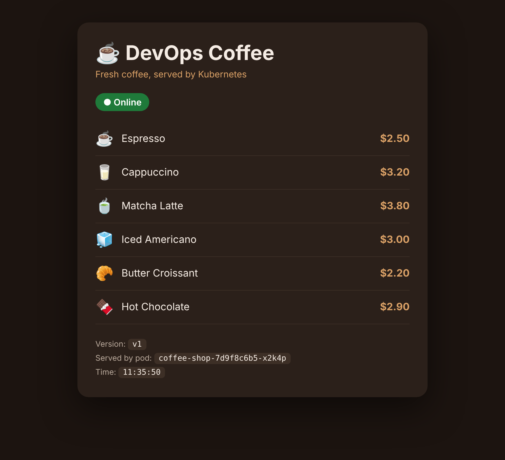

# ☕ DevOps Coffee: a real app that crashes, and Claude AI fixes it



> 🎥 From the **DevOps with Umesh** YouTube video *"My Kubernetes App Crashed… Claude AI Fixed It (Hands-On)"*.
> Deploy it, break it, and let Claude fix it yourself.

**Quick start**
```bash
git clone https://github.com/DevOps-with-Umesh/coffee-shop-app.git
cd coffee-shop-app
chmod +x scripts/*.sh
./scripts/deploy.sh
./scripts/open-app.sh   # then open http://localhost:8888
```

A real website running on **your local Kubernetes** at **http://localhost:8888**.
A teammate's bad deploy takes it down → **Claude Code** finds the cause and brings it back.

```
coffee-shop-app/
├── app.yaml                     ← the whole app (code + Deployment + Service)
├── README.md                    ← this guide
├── SOLUTIONS.md                 ← answer key (try fixing it yourself first!)
├── RECORDING-GUIDE.md           ← 🎥 record the video automatically
├── preview.png                  ← what the working site looks like
├── scripts/
│   ├── demo.sh                  ← 🎬 runs the WHOLE video automatically
│   ├── deploy.sh                ← deploy healthy v1
│   ├── open-app.sh              ← opens the app on localhost:8888 (keep running)
│   ├── glitch-1-bad-config.sh   ← 💥 v2 with a config typo  → CrashLoopBackOff
│   ├── glitch-2-bad-image.sh    ← 💥 image tag typo         → ImagePullBackOff
│   ├── glitch-3-memory.sh       ← 💥 bonus: memory           → OOMKilled
│   ├── status.sh                ← show pods
│   └── reset.sh                 ← back to healthy v1
└── claude-workspace/
    └── CLAUDE.md                ← rules for Claude. Start `claude` from HERE.
```

> 🎬 **Want it automatic?** Run `./scripts/demo.sh` and see `RECORDING-GUIDE.md`.
> The steps below are the same flow done by hand.

---

## What you need (you already have all of this ✅)

| Tool | What it is | How you got it |
|---|---|---|
| **Docker Desktop + Kubernetes** | Runs Kubernetes on your Mac | Docker Desktop → Settings → **Kubernetes** → *Enable Kubernetes* |
| **kubectl** | Talks to the cluster | `brew install kubectl` |
| **Claude Pro subscription** | Your Claude plan. It includes Claude Code, no API key needed | claude.ai → Upgrade (Pro or Max) |
| **Claude Code** | Claude in your Terminal, runs commands for you | `curl -fsSL https://claude.ai/install.sh \| bash` |

Claude Code login (one time): run `claude` → choose **"Claude account with subscription"** → approve in the browser.

---

## STEP 1: Put the app folder in place
```bash
git clone https://github.com/DevOps-with-Umesh/coffee-shop-app.git
cd coffee-shop-app
chmod +x scripts/*.sh
```

## STEP 2: Deploy the app (healthy v1)
```bash
./scripts/deploy.sh
```
Wait for: `deployment "coffee-shop" successfully rolled out` ✅

## STEP 3: Open it in your browser
Open a **second Terminal tab** (Cmd + T), then:
```bash
cd coffee-shop-app && ./scripts/open-app.sh
```
Leave that tab running. Open **http://localhost:8888** in Chrome or Safari.
You'll see the **DevOps Coffee** menu with a green **● Online** badge and **Version v1**. 🎉

> Port 8888 is used because 8080 may already be taken by your Jenkins.

## STEP 4: Break it 💥
Back in the **first** tab:
```bash
./scripts/glitch-1-bad-config.sh
```
Wait ~20 seconds → refresh the browser → **"This site can't be reached"** ❌
```bash
kubectl get pods -n coffee
```
→ `CrashLoopBackOff`

## STEP 5: Fix it with Claude (manual mode, you approve each step)
```bash
cd coffee-shop-app/claude-workspace
claude --permission-mode default
```
Bottom line must say **"⏸ manual mode on"** (Shift + Tab to change).
Paste this:
```
Our DevOps Coffee website at localhost:8888 went down right after the team deployed v2.
It runs in the "coffee" namespace. Find out why it's down and fix it.
```
- Claude runs `kubectl get pods`, `describe`, `logs`… and asks before each one → choose **1. Yes**.
- It finds: `FATAL: APP_PORT environment variable is not set` → the deploy renamed it to `APP_PROT`.
- It asks to run the fix → **1. Yes**.

Refresh the browser in ~15 seconds → **● Online, Version v2** ✅
*(The new version is live, now working.)*

Type `/exit` when done.

## STEP 6: Break it again, and fix it in AUTO mode 🤖
```bash
cd coffee-shop-app && ./scripts/glitch-2-bad-image.sh
```
Refresh → down again. Now start Claude in **auto mode**:
```bash
cd claude-workspace && claude --permission-mode auto
```
Bottom line: **"⏵⏵ auto mode on"**. Paste:
```
The DevOps Coffee website is down again after another deploy. Namespace "coffee". Investigate and fix it.
```
Claude now works **without asking you**: it checks each command for risk and runs the safe ones
by itself. It finds the image typo `python:3.12-alpne`, fixes it, and the site comes back ✅

## STEP 7 (bonus): Memory crash
```bash
cd coffee-shop-app && ./scripts/glitch-3-memory.sh
```
→ `OOMKilled`. Same Claude prompt. Good for a YouTube Short.

## Reset any time
```bash
./scripts/reset.sh
```
Back to a healthy v1. If the browser doesn't load after a reset, restart `open-app.sh` (Ctrl + C, run it again).

---

## Manual mode vs Auto mode

| | ⏸ Manual mode | ⏵⏵ Auto mode |
|---|---|---|
| Start with | `claude --permission-mode default` | `claude --permission-mode auto` |
| Who approves commands | **You**, every single one | **Claude**, after a safety check on each command |
| Speed | Slower | Faster |
| Best for | Production, learning, anything risky | Local labs, dev clusters, routine work |
| Switch while running | **Shift + Tab** | **Shift + Tab** |

---

## 🛟 Troubleshooting
| Problem | Fix |
|---|---|
| Browser: "can't be reached" even before a glitch | Is `open-app.sh` running in the other tab? Run `./scripts/status.sh` to check that the pod is `1/1 Running` |
| Site stays down after Claude's fix | Wait 15 s and refresh. Still down? Ctrl + C in the `open-app.sh` tab and run it again |
| `deploy.sh` times out | First run downloads the Python image. Run `./scripts/deploy.sh` again |
| Claude lists your AWS EKS cluster | Blur the AWS account number in your video editor |
